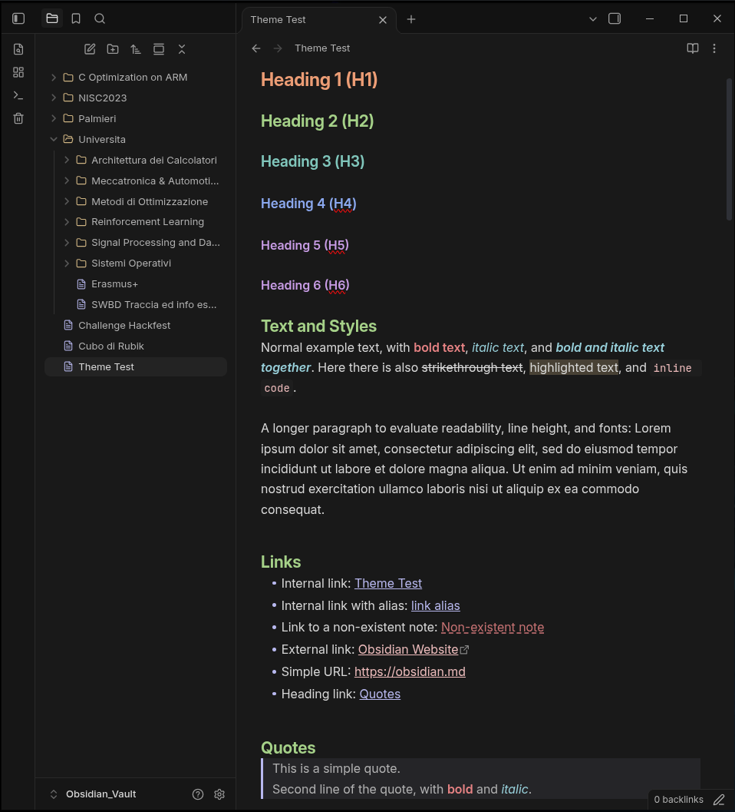
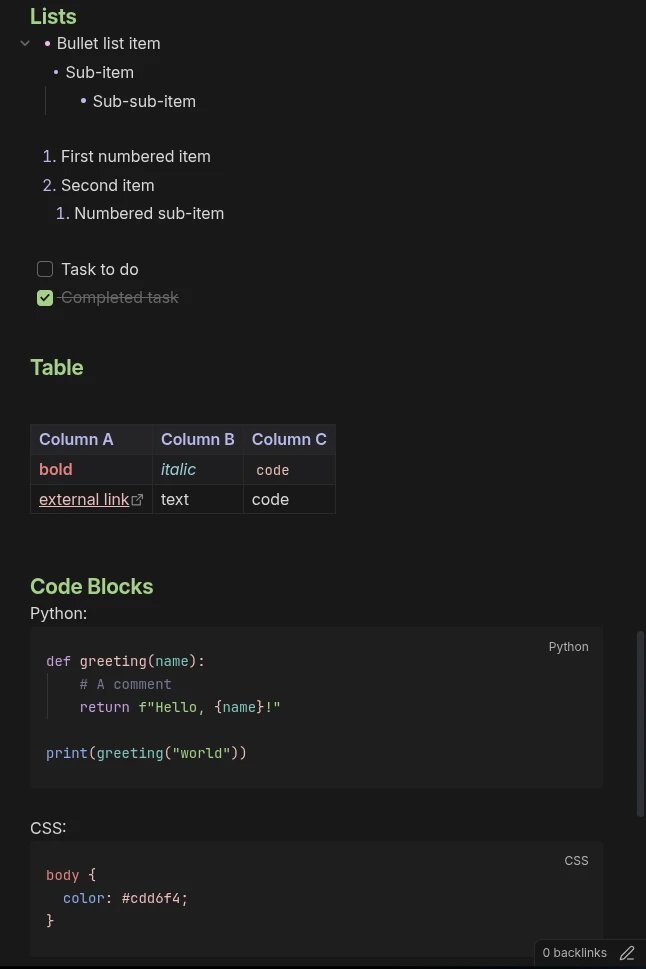
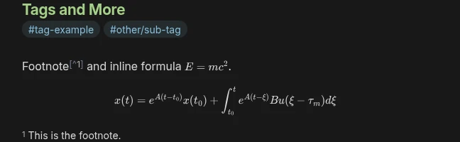

# Moonpetal

A soft, eye-friendly theme for Obsidian featuring pastel text colors on a soft dark background or a warm paper light background. The color palette is adapted from Catppuccin (Frappé and Latte).

## Features
- Carefully tuned pastel palette designed to reduce eye strain.
- Pure CSS with zero bloat.
- Custom styling for headings, inline formatting, code blocks, lists, and tables.
- Integrated file explorer icons with custom color-coded indicators.
- Fully supports both Obsidian Dark and Light modes.

## Showcase

> This theme and its CSS files were generated with the assistance of AI.

## Installation

### Via Obsidian (Recommended)
Use this [link](https://community.obsidian.md/themes/moonpetal) or follow the following instruction:
1. Open Obsidian and go to **Settings > Appearance > Themes > Manage**.
2. Search for **Moonpetal**.
3. Click **Install and Use**.

### Manual Installation

#### Install as a Theme
1. Clone this repository into `your_vault_path/.obsidian/themes/`, you only need `theme.css` and `manifest.json`;
2. Open Obsidian, go to **Settings > Appearance**, and select **Moonpetal**.

#### Install as a CSS snippet
1. Copy `theme.css` into `your_vault_path/.obsidian/snippets/`.
2. Open Obsidian, go to **Settings > Appearance > CSS snippets**, and enable the snippet.

## License
Distributed under the MIT License. See `LICENSE` for details.